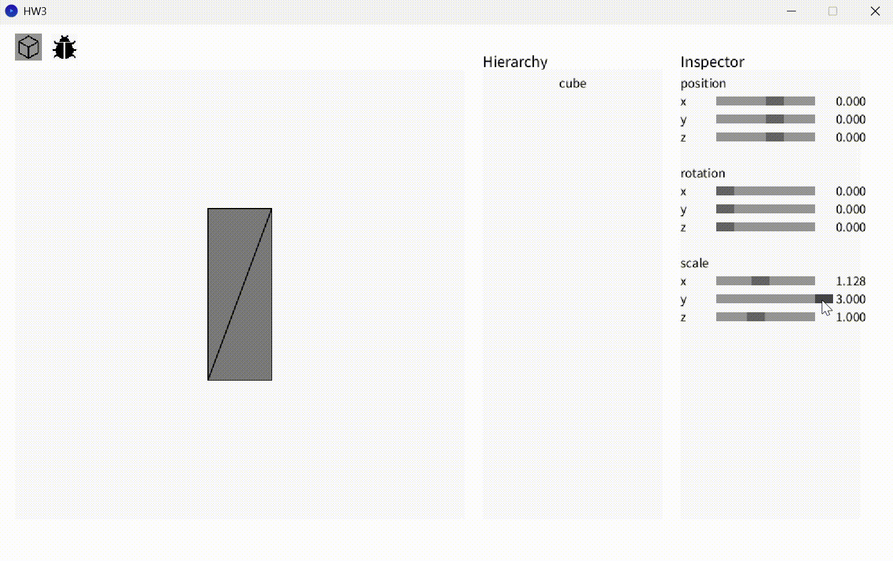
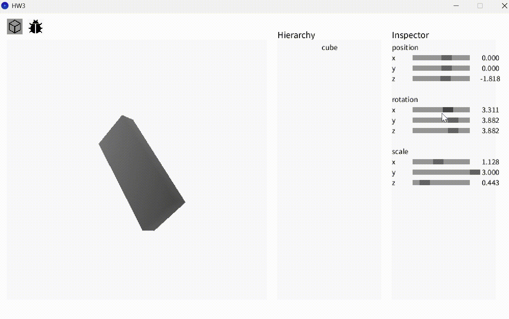
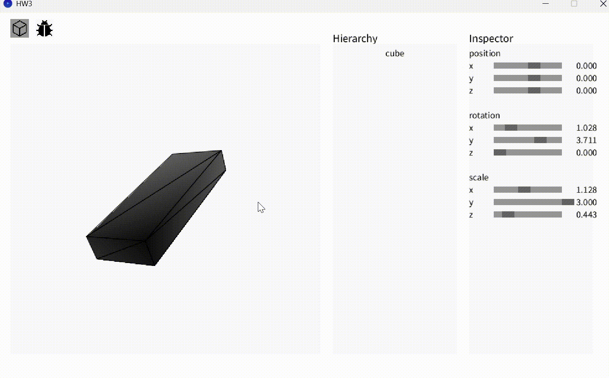
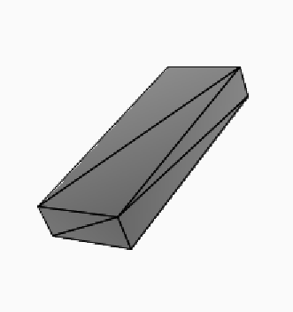
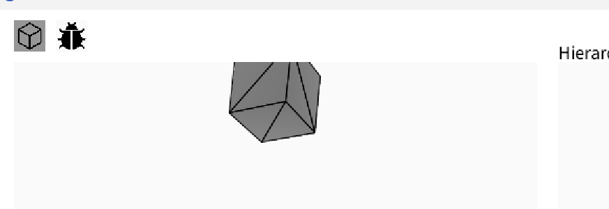

# HW3 - 3D Rendering Engine

本專案使用 Processing 實作簡易的 3D 繪製引擎。
使用者可以載入 `.obj` 模型，並透過 Inspector 調整物件的位置、旋轉與縮放。


## 已完成功能

### FUNDAMENTAL

#### 1. 模型矩陣、觀察矩陣與投影矩陣（40%）

- 已於 `GameObject.pde` 實作 `localToWorld()`。
- 已實作模型平移、旋轉與縮放矩陣。
- 已於 `Camera.setSize(...)` 實作投影矩陣。
- 已於 `Camera.setPositionOrientation(...)` 實作相機觀察矩陣。
- 最終透過以下方式組合 MVP 矩陣：

```text
MVP = 投影矩陣 × 觀察矩陣 × 模型矩陣
```


#### 2. Depth Buffer 深度緩衝（20%）

- 已為畫面中的每個像素建立深度緩衝。
- 每一幀繪製前會重置深度緩衝與畫面緩衝。
- 已透過 `getDepth(...)` 從三角形平面插值計算像素深度。
- 將像素深度與 `GH_DEPTH[index]` 進行比較。
- 保留深度較近且有效的像素內容。
- 後續將深度值重新映射到灰階後，增加畫面中深度差異的對比度，方便觀察模型表面的深度變化。

```java
public class DepthFragmentShader extends FragmentShader {
    Vector4 main(Object[] varying) {
        Vector3 position = (Vector3) varying[0];
        float d = map(position.z, 0.98f, 1.0f, 0.0f, 1.0f); // 暫時拉高對比測試
        return new Vector4(d, d, d, 1.0);
        //return new Vector4(position.z, position.z, position.z, 1.0);
    }
}
```



#### 3. 相機控制（20%）

- 已實作以下相機移動按鍵：

| 按鍵 | 相機移動 |
|---|---|
| `W` | 向前移動 |
| `S` | 向後移動 |
| `A` | 向左移動 |
| `D` | 向右移動 |
| `R` | 向上移動 |
| `F` | 向下移動 |

- 相機位置變更後，每一幀會重新計算觀察矩陣。
- 相機移動時，觀看目標保持固定。



#### 4. 背面剔除（20%）

- 已於 `debugDraw()` 實作背面偵測。
- 將三角形轉換至標準化裝置座標。
- 計算三角形的邊向量與法向量。
- 使用螢幕座標法向量的 Z 分量，略過背向相機的三角形邊。
- 正負判斷已考慮觀察轉換中的 X 軸鏡射方向。


## Bonus：3D Clipping

部分模型的頂點或邊可能超出畫布範圍，導致畫線時延伸到畫面外。
因此使用 3D Clipping，將超出 Clip Space 邊界的三角形邊線進行裁切。

- 功能實作於 `GameObject` 類別。
- 先取得 MVP 變換後的 `Vector4` 座標，保留在 Clip Space。
- 對三角形的每一條邊依序檢查六個裁切平面：
  - 左平面：`w + x >= 0`
  - 右平面：`w - x >= 0`
  - 下平面：`w + y >= 0`
  - 上平面：`w - y >= 0`
  - 近平面：`z >= 0`
  - 遠平面：`w - z >= 0`
- 線段與裁切平面相交時，在 4D Clip Space 中計算交點。
- 裁切完成後，再執行 `.homogenized()` 進入 NDC Space。
- 最後將裁切後的端點轉換至 Screen Space 並繪製。

簡化流程：

```text
Triangle Edge
  → MVP / Clip Space
  → clipLine()
  → 六個裁切平面處理
  → homogenized()
  → NDC Space
  → map()
  → Screen Space
```


## 操作方式

- 點擊載入按鈕以開啟 `.obj` 模型檔案。
- 範例模型位於 `HW3/data/Meshes/`。
- 在 Hierarchy 中選擇物件後，可於 Inspector 調整參數。
- 使用位置、旋轉與縮放滑桿來變換模型。
- 按下 `W`、`S`、`A`、`D`、`R` 或 `F` 移動相機。
- 點擊 Debug 按鈕以開啟或關閉三角形邊線顯示。


## AI 協助

在開發過程中，AI 協助完成以下工作：

- 協助理解 HW2 程式中標記為 `TODO HW2` 的矩陣、裁切與變換相關內容，並將已理解的部分套用到 HW3。
- 協助閱讀並整理 `Matrix4`、`localToWorld()`、`worldToLocal()` 與相機矩陣的座標轉換流程。
- 協助診斷相機、投影矩陣、深度緩衝與填色流程中可能造成畫面異常的原因。
- 協助理解透視投影、深度插值、Backface Culling 與繪製流程之間的差異。
- 協助整理相機控制按鍵與檔案載入流程。
- 協助撰寫本 README，將已完成功能、操作方式與除錯重點整理成文件。

## 座標空間流程

在 3D 渲染流程中，一個頂點會依序經過下列座標空間：

| 階段 | 空間名稱 | 意義（座標原點） | HW3 中對應的程式 |
|---|---|---|---|
| 1 | Local Space（Model Space） | 模型自己的座標；座標值來自 `.obj` 檔案 | `triangle.verts[j]` |
| 2 | World Space | 整個 3D 世界的座標；包含模型平移、旋轉與縮放 | 乘上 `localToWorld()`，即 Model Matrix |
| 3 | Eye Space（View / Camera Space） | 以相機為原點；世界座標需要跟著相機反方向轉換 | 乘上 `worldView`，即 View Matrix |
| 4 | Clip Space（Projection Space） | 完成透視變形後的 4D 坐標 `(x, y, z, w)`，尚未除以 `w`；此階段進行 3D Clipping | 呼叫 `MVP.mult(...)` 後得到的 `Vector4` |
| 5 | NDC Space | 將 4D 坐標除以 `w` 後的標準化座標，座標範圍通常落在 `-1` 到 `1`；可在此階段進行 Backface Culling 與 Depth Buffer 判斷 | 呼叫 `.homogenized()` 後得到的 `Vector3` |
| 6 | Screen Space | 對應實際視窗像素位置，例如寬度 `20~520`、高度 `50~550` | 呼叫 `map(..., -1, 1, ...)` 後得到的螢幕座標 |

簡化後的流程如下：

```text
Local Space
  → localToWorld()
World Space
  → worldView
Eye Space
  → projection
Clip Space
  → homogenized()
NDC Space
  → map()
Screen Space
```
