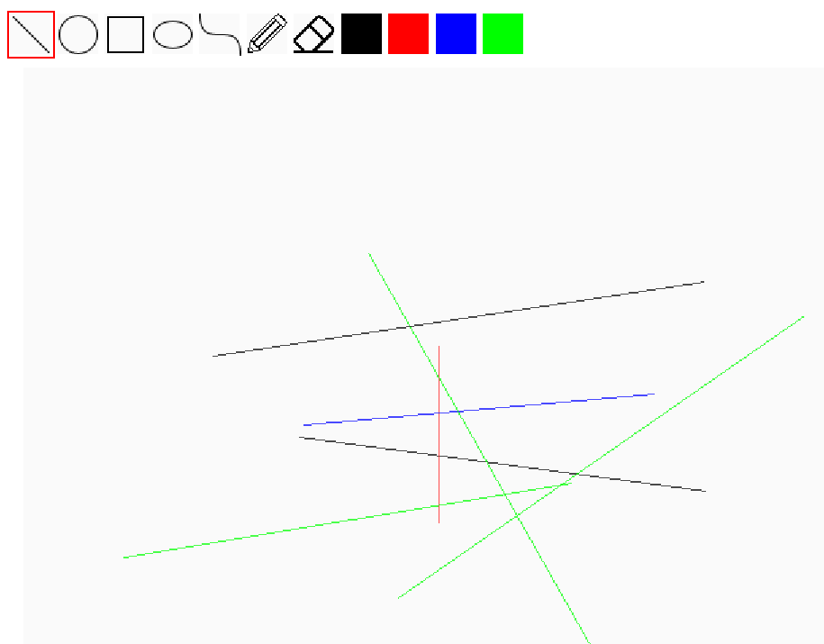
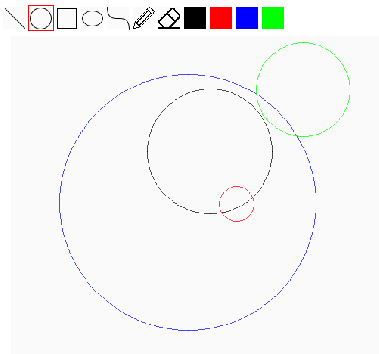
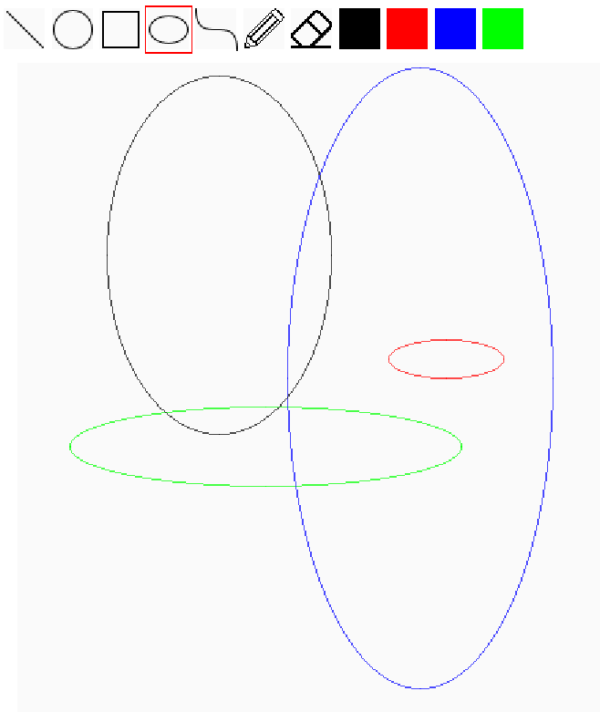
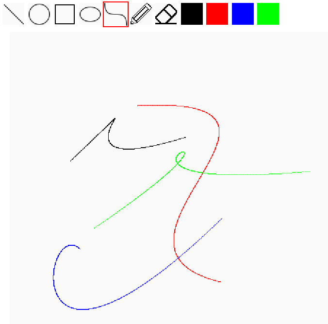
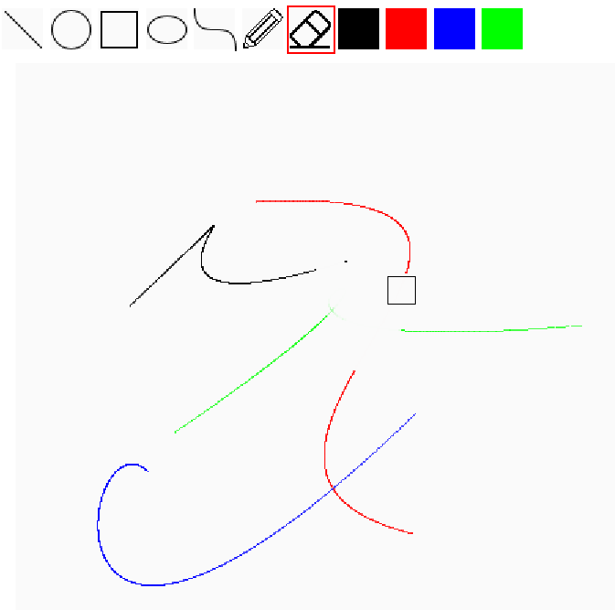
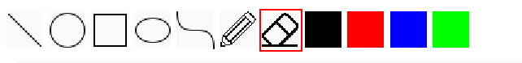

完成實作功能：
1. Line:
使用 Midpoint Line Algorithm，透過判別值 d 決定下一個像素的位置。為了處理不同斜率與方向的線段，我先交換 X、Y 座標來處理平緩線與陡峭線，再調整起終點順序及方向，讓主要迴圈能用相同的邏輯完成繪製。(所有的線都是以左上右下的陡峭線來計算，繪圖實再回復原先的x,y值)
```
if(abs(y2 - y1) < abs(x2 - x1)){ //平緩線 交換x,y
        x=y1; x_2=y2;
        y=x1; y_2=x2;
        is_flat=true;
    }
      
    if( y>y_2){  //X軸左右，交換起終點 x1,x2; y1,y2 確保依然是往下走
        float tx=x; float ty=y;  //必須要使用tx, ty不然會又被初始值覆蓋
        x=x_2; x_2=tx;
        y=y_2;y_2=ty;
    }
    if (x > x_2) { //右上左下 確保依然是往右走
        x = -x;
        x_2 = -x_2;
        is_neg_x = true;
    }
```


2. Circle:
使用 Midpoint Circle Algorithm，從圓心的相對座標 (0, r) 開始，利用判別值決定每一步的座標更新方式。再利用圓的八對稱性，一次繪製八個對稱位置，減少重複計算。
```
float offsetx = 0; //因為課本公式是以(0,0)為原點，所以用offset取代x,y
    float offsety = r;
    float d = 5/4 - r;

    while(offsetx <= offsety){
        drawPoint(x+offsetx, y+offsety, save_color);
        drawPoint(x+offsetx, y-offsety, save_color);
        drawPoint(x-offsetx, y-offsety, save_color);
        drawPoint(x-offsetx, y+offsety, save_color);
        drawPoint(x+offsety, y+offsetx, save_color);
        drawPoint(x+offsety, y-offsetx, save_color);
        drawPoint(x-offsety, y+offsetx, save_color);
        drawPoint(x-offsety, y-offsetx, save_color);
        ...
```


3. Ellipse: 
使用助教提供的網址的 Midpoint Ellipse Algorithm，將橢圓分成兩個區域，分別根據判別值決定座標更新方式。每次計算後繪製四個對稱點，直到完成橢圓。
```
float dx, dy, d1, d2, xp, yp;
    xp = 0;
    yp = r2;

    // 陡峭區域
    d1 = (r2 * r2) - (r1 * r1 * r2) + (0.25 * r1 * r1);
    dx = 2 * r2 * r2 * xp;
    dy = 2 * r1 * r1 * yp;
...
```


4. Bézier Curve:
參考助教提供的網站，帶入四點(三次) Bézier 曲線公式，以四個控制點計算曲線上的座標。讓參數 t 從 0 逐步增加到 1，每次計算一個點並繪製，將這些點連成曲線。
```
for (float t = 0; t <= 1; t += 0.001f) {  //這邊要記得改成float移動，不然只有 t=0,1
        float min_t = 1 - t;
        float xp = pow(min_t, 3) * p1.x()
            + 3 * pow(min_t, 2) * t * p2.x()
            + 3 * min_t * pow(t, 2) * p3.x()
            + pow(t, 3) * p4.x();
        float yp = pow(min_t, 3) * p1.y()
            + 3 * pow(min_t, 2) * t * p2.y()
            + 3 * min_t * pow(t, 2) * p3.y()
            + pow(t, 3) * p4.y();
        drawPoint(xp,yp, save_color);
    }
```


5. Eraser:
使用兩層迴圈逐一走訪橡皮擦矩形範圍內的像素，並將它們改成背景色 color(250)
```
float xp=p1.x();
    float yp=p1.y();
    for(xp=p1.x();xp<=p2.x();xp++){
            for(yp=p1.y();yp<=p2.y();yp++){
            drawPoint(xp, yp, color(250));
        }
    }
```


Bonus:
6. color button:
實作黑、紅、綠、藍四種顏色的按鈕。新增 current_color 全域變數，繪圖後會儲存顏色後面改變不會被影響。點擊按鈕後更新目前使用的顏色，並將選取的顏色傳入繪圖函式，讓後續繪製的圖形使用該顏色。
```
blackButton.run(()->{
        currentColor=color(0,0,0); //改全域變數
    });
redButton.run(()->{
    currentColor=color(255,0,0);
});
...
```
```
public class EllipseRenderer implements Renderer{
  private boolean once;
  private int times;
  private Vector3 center;
  private float radius1 = 0;
  private float radius2 = 0;
  private color save_color; //儲存顏色
```
```
public void CGCurve(Vector3 p1, Vector3 p2, Vector3 p3, Vector3 p4, color save_color) { //根據顏色去繪圖
...
drawPoint(xp,yp, save_color);
```


AI 使用說明:

這次作業有使用 AI 輔助理解程式與除錯，主要用在以下幾個方面：
1. 理解程式架構： 協助我快速了解助教提供的程式，例如參數的用途、滑鼠點擊與拖曳的操作順序，以及 Processing 的座標系統和 color() 等基本用法。
2. 演算法理解： 我會先自行思考演算法的原理與實作方式，遇到程式結果不符合預期時，再與 AI 討論自己的推導過程，找出演算法邏輯上的問題並釐清正確的思考方向。
3. 程式實作與除錯： 在實作過程中，利用 AI 協助檢查程式邏輯、分析不同輸入或圖形方向下的問題，再自行修改程式並確認結果。