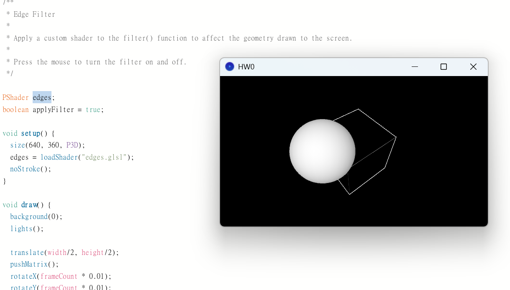

執行助教的HW0程式

一開始不知道為甚麼一直顯示: "The file "edges.glsl" is missing or inaccessible, make sure the URL is valid or that the file has been added to your sketch and is readable. NullPointerException NullPointerException"

但後來我亂上傳edges.glsl後，他自己生成一個edges資料夾，然後莫名其妙就好了。現在把多餘的edges資料夾刪掉也可以跑了，希望之後不會遇到同樣的問題。不懂..........