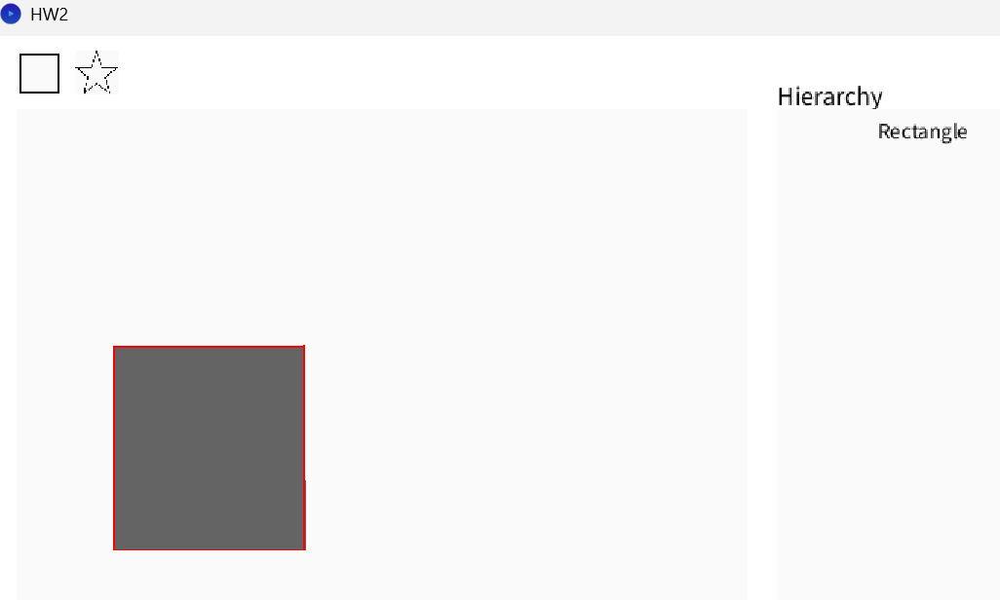
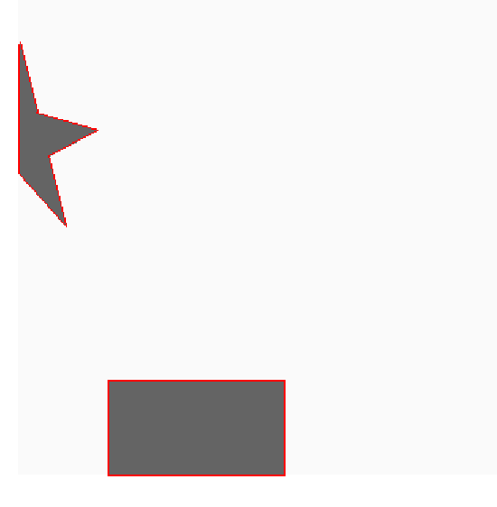
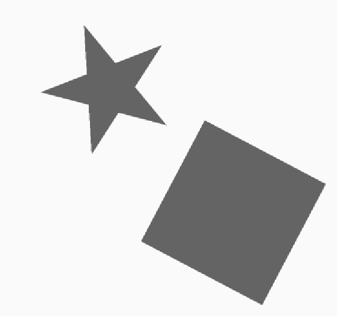

作業:
1. 完成 Translation Matrix, Scaling Matrix, Rotation Matrix 使用課程中教過的矩陣  
以scaling作為範例:
```java
    m[0] = s.x; m[1] = 0.0f; m[2] = 0.0f; m[3] = 0.0f;
    m[4] = 0.0f; m[5] = s.y; m[6] = 0.0f; m[7] = 0.0f;
    m[8] = 0.0f; m[9] = 0.0f; m[10] = s.z; m[11] = 0.0f;
    m[12] = 0.0f; m[13] = 0.0f; m[14] = 0.0f; m[15] = 1.0f;
```
對應：

$$
S(s_x,s_y,s_z)=
\begin{bmatrix}
s_x & 0 & 0 & 0\\
0 & s_y & 0 & 0\\
0 & 0 & s_z & 0\\
0 & 0 & 0 & 1
\end{bmatrix}
$$


2. 完成 pnpoly  
固定y，從檢查點往右畫一條水平線，如果水平線與圖形邊線有交點，parity反轉，最後如果是奇數代表該點在圖形內，反之。  
重點程式:
```java
if((y>yi)!=(y>yj)){  //如果沒有通過任何邊，換檢查下一個
    if(yi!=yj){ //水平線就跳過
        float x_intersect = xi + (y - yi) * (xj - xi) / (yj yi); //計算交會點
                    
        // 如果交點在測試點的左邊，狀態反轉
        if (x > x_intersect){inside = !inside;}
    }
}
```


3. 完成 findBoundBox  
基本上就是找最小以及最大的x,y數值
```java
float minx = v[0].x; float miny = v[0].y;
    float maxx = v[0].x; float maxy = v[0].y;
    for(int i=1; i<v.length;i++){
        if(v[i].x>maxx)maxx=v[i].x;
        if(v[i].x<minx)minx=v[i].x;
        if(v[i].y>maxy)maxy=v[i].y;
        if(v[i].y<miny)miny=v[i].y;
    }
```

4. 完成 Sutherland Hodgman Algorithm  
根據課程所教的作法，每個邊界都切一次，並且計算圖形每個邊是否有超出邊界，最後所有邊都會在邊界內。  
內 → 內：加入 P  
內 → 外：加入交點  
外 → 內：加入交點，再加入 P  
外 → 外：不加入  
```
input = 原始多邊形頂點
for boundary 的每一條邊：
    output = 空集合
    S = input 的最後一個頂點
    for P = input 中的每一個頂點：
        if P 在 boundary 內、S 在 boundary 內：
            加入 P
        else if P 在外、S 在內：
            加入 S 到 P 的交點
        else if P 在內、S 在外：
            加入 S 到 P 的交點
            加入 P
        else：
            不加入任何東西
        S = P
    input = output
return input
```


AI協助部分:  
- 協助找出 CGLine 使用浮點數判斷終止條件，可能造成無限迴圈的問題。
- 參考 AI 釐清並檢查各項演算法的概念與實作細節，程式由本人理解後完成。
- 利用AI協助撰寫兩條線的交點公式。

5. Bonus：SSAA（2 × 2 Super-Sampling）  
本 bonus 部分由本人理解需求後與 AI 協作完成：AI 協助設計 2 × 2 sample buffer、depth/color buffer 與 resolve 流程；程式內容、整合方式及是否符合專案需求由本人確認並調整。

在原本的像素中心內，以 2 × 2 取樣方式取得四個 sub-pixel：
```text
(0.25, 0.25)  (0.75, 0.25)
(0.25, 0.75)  (0.75, 0.75)
```


程式邏輯如下：

1. 使用 `pnpoly()` 判斷每個 sub-pixel 是否位於圖形內。
2. 每個螢幕像素維護四個 sample，每個 sample 分別記錄是否被圖形覆蓋、depth 和顏色。
3. 新圖形寫入 sample 時會比較 depth，保留較近面的資料。
4. 所有圖形繪製完成後，對每個像素的四個 sample 作平均 resolve，藉由不同 coverage 混合邊緣顏色，減少鋸齒。

(目前實作把圖形的平面深度存入每個 sample，並未呼叫 `CGLine()` 繪製額外紅色邊框。)

